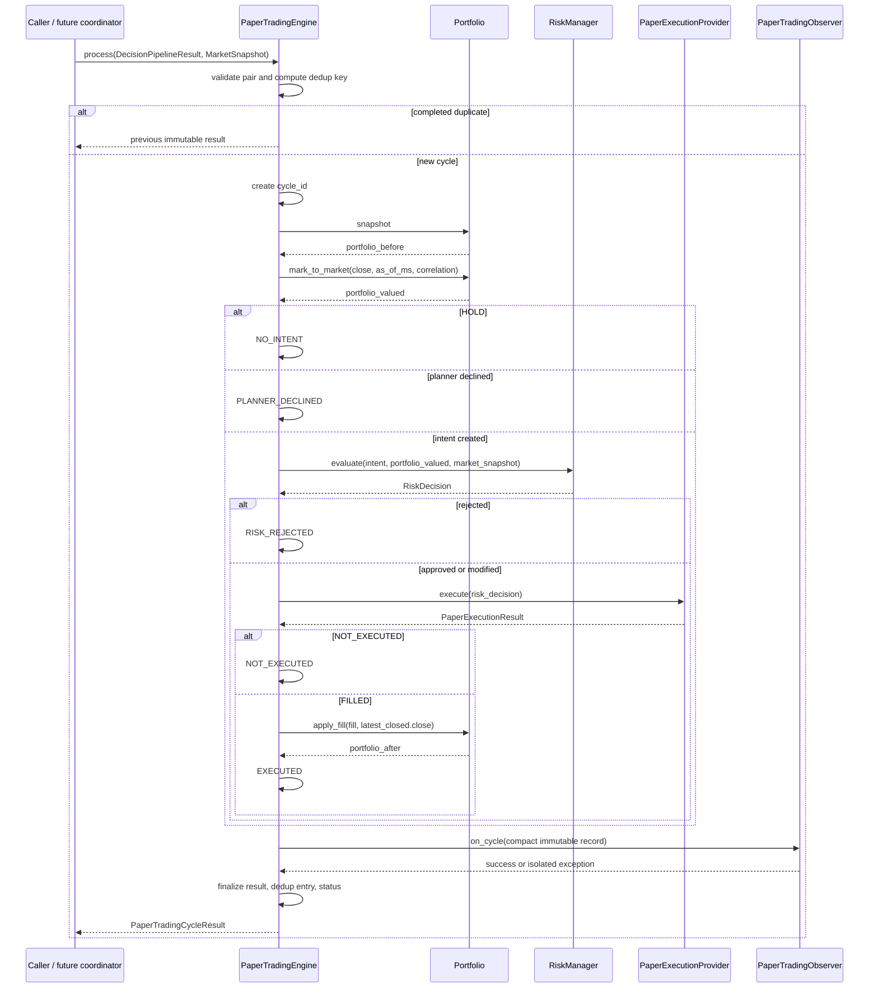

# Paper Trading Orchestration

## 1. Status and scope

- Status: **M3.8 design review completed; final architecture approved for implementation**.
- Date: 2026-08-05.
- M3.7 orchestration design: **completed**.
- M3.8 design review: **completed**.
- M3.9 implementation: **completed; final safety review passed** (2026-08-05).

`PaperTradingEngine` is a synchronous application service that coordinates existing
domain components. It contains no Strategy, indicators, sizing, fee or accounting
formula and does not read Market Cache, Binance, wall time or network resources.

```text
CandleClosed
    -> Decision Pipeline (once)
    -> DecisionPipelineResult
    -> PaperTradingEngine
         -> Portfolio.mark_to_market
         -> RiskManager.evaluate
         -> PaperExecutionProvider.execute
         -> Portfolio.apply_fill
    -> PaperTradingCycleResult
    -> PaperTradingObserver
```

The engine never submits a real order. It is paper-only and cannot select a live or
testnet adapter through a feature flag.

## 2. Recommended public API

```text
PaperTradingEngine(
    config: PaperTradingEngineConfig,
    portfolio: Portfolio,
    risk_manager: RiskManager,
    execution_provider: ExecutionProvider,
    cycle_id_factory: PaperTradingCycleIdFactory,
    observer: PaperTradingObserver,
    monotonic_clock: MonotonicClock,
)

process(
    decision_result: DecisionPipelineResult,
    market_snapshot: MarketSnapshot,
) -> PaperTradingCycleResult

status -> PaperTradingEngineStatus
```

`Portfolio` is injected once and is the engine's only mutable state dependency. A
`PortfolioSnapshot` parameter is not accepted: the engine must read the authoritative
aggregate immediately before valuation and apply the Fill to that same aggregate.

The first implementation uses the existing public
`RiskManager.evaluate(intent, portfolio, market_snapshot)` API unchanged. Execution
uses the existing `ExecutionProvider.execute(decision)` port. The engine does not own
or close either dependency.

There is no `start()`/`stop()` in the core implementation. A later runtime coordinator
owns event subscription and lifecycle.

### 2.1 Lifecycle

The engine has a composition lifetime, not a background-worker lifetime:

1. the composition root validates configuration and constructs all dependencies;
2. the engine starts in `IDLE` with empty bounded dedup state and zero counters;
3. the caller invokes `process()` synchronously for one already-computed decision;
4. activity changes to `PROCESSING` for the call and returns to `IDLE` in `finally`;
5. the composition root releases references at application shutdown.

There is no `start`, `run_forever`, `request_stop`, `close`, internal queue, worker or
subscription. Concurrent or re-entrant `process()` is outside the single-writer
contract and is rejected with a typed busy-state error. The same instance may process
the next cycle after an ordinary classified failure. After an ambiguous post-execution
invariant failure, the instance becomes degraded and must be reconstructed after
Portfolio inspection.

### 2.2 Composition root and ownership

The future application composition root constructs, validates and owns:

- one `Portfolio` for the configured stream;
- one existing `RiskManager`;
- one existing `PaperExecutionProvider` through the existing `ExecutionProvider` port;
- config, cycle-ID factory, observer and monotonic clock;
- the future coordinator that shares one `DecisionPipelineResult` between consumers.

The engine owns only its bounded dedup registry, counters, activity and last safe
diagnostics. It does not close, replace or reconfigure injected dependencies. Risk and
execution remain stateless; Portfolio is the authoritative mutable single-writer
aggregate. Observer and factories are externally owned ports. All inputs and results
are immutable.

Composition validates all alignment exposed by current public APIs: Risk and paper
execution use the same stream/rules version, and Portfolio snapshot uses that stream.
The engine does not reach into Portfolio private configuration. Remaining rule
consistency is enforced by existing Risk, Execution and Portfolio validation. No
service locator, global singleton or dependency construction inside `process()` is
allowed.

## 3. Configuration

Immutable `PaperTradingEngineConfig`:

- `engine_name = "paper_trading"`;
- `engine_version = "1.0.0"`;
- `dedup_capacity = 10000`, positive integer;
- `observe_no_intent = True`;
- `observe_risk_rejected = True`;
- `mark_to_market_on_no_intent = True`.

The first implementation fixes `mark_to_market_on_no_intent=True`; exposing `False`
would create discontinuous equity history and should not be configurable until a real
consumer requires it.

## 4. Preferred processing flow

For every closed-candle decision:

1. Validate `DecisionPipelineResult` against `MarketSnapshot` without mutation.
2. Compute the dedup key and return the prior immutable result on a hit.
3. Create and validate `cycle_id`.
4. Read the current `portfolio.snapshot`.
5. Mark Portfolio to the latest closed candle close and snapshot time.
6. If pipeline outcome is HOLD, build `NO_INTENT`.
7. If planner declined, build `PLANNER_DECLINED`.
8. Otherwise evaluate Risk with the valued Portfolio snapshot.
9. If Risk rejects, build `RISK_REJECTED`; do not call execution.
10. Execute only APPROVED/MODIFIED RiskDecision.
11. If execution returns NOT_EXECUTED, build `NOT_EXECUTED`; do not apply a Fill.
12. For FILLED, validate IDs and call `Portfolio.apply_fill(fill, reference_price)`.
13. Build the provisional business result and compact observer record.
14. Notify observer once; convert a handler failure into explicit delivery degradation.
15. Finalize the immutable result, store it in bounded dedup and update status.

No retry occurs inside a cycle. The engine never edits an intent, approval, Fill or
snapshot and never recalculates quantity, gross, fee or PnL.

### 4.1 Full sequence diagram



Strategy and `TradingDecisionPipeline.evaluate()` are deliberately absent: the caller
must supply their already-computed result.

## 5. Mark-to-market ownership

The engine is the sole mark-to-market authority for paper cycles:

```text
reference_price = market_snapshot.latest_closed_candle.close

portfolio_valued = portfolio.mark_to_market(
    mark_price=reference_price,
    as_of_ms=market_snapshot.as_of_ms,
    correlation_id=decision_result.correlation_id,
)
```

This happens for HOLD, planner declined and every intent. It is a committed non-trade
state update even when Risk rejects or execution fails. The cycle result records
`portfolio_valued_before_risk=True`, the snapshot before the call and the valued
snapshot used by Risk.

Rationale: continuous equity, unrealised PnL and drawdown history must not depend on
whether a candle happens to produce an intent. Moving valuation outside the engine
would split ownership and make Risk synchronization implicit.

Dedup is checked before valuation, so a duplicate cannot create another Portfolio
version. A mark failure stops before Risk and execution.

## 6. HOLD and planner-declined semantics

HOLD:

- Portfolio is valued;
- Risk and execution are not called;
- no Fill is applied;
- outcome is `NO_INTENT`;
- reason is copied from the pipeline result;
- observer receives a compact record when configured.

Planner decline follows the same no-trade path but uses the separate outcome
`PLANNER_DECLINED`. It is not a HOLD and not a Risk rejection.

## 7. Business outcomes

Minimal `PaperTradingCycleOutcome`:

- `NO_INTENT`;
- `PLANNER_DECLINED`;
- `RISK_REJECTED`;
- `NOT_EXECUTED`;
- `EXECUTED`.

`EXECUTION_FAILED`, `PORTFOLIO_FAILED` and generic `FAILED` are not business outcomes.
Unexpected component failures raise typed errors with immutable failure context. An
observer failure is delivery degradation recorded separately and never changes an
already determined business outcome.

`NOT_EXECUTED` is a defensive outcome for a compatible execution provider returning a
valid no-fill result. The current engine normally does not call execution for rejected
Risk decisions.

## 8. Immutable cycle result

Recommended `PaperTradingCycleResult` fields:

```text
cycle_id
decision_pipeline_run_id
market_snapshot_id
signal_id
intent_id | None
risk_decision_id | None
execution_id | None
fill_id | None
portfolio_id
portfolio_version_before
portfolio_version_valued
portfolio_version_after
portfolio_snapshot_before
portfolio_snapshot_valued
portfolio_snapshot_after
decision_result
risk_decision | None
execution_result | None
outcome
reason_code
correlation_id | None
completed_stages: tuple[PaperTradingStage, ...]
portfolio_valued_before_risk: bool
decision_duration_ms: int | None
risk_duration_ms: int
execution_duration_ms: int
portfolio_duration_ms: int
observation_duration_ms: int
total_duration_ms: int
observation_status
failure_category | None
failure_message | None
metadata: deeply immutable mapping
```

Full immutable nested inputs/results are retained in memory for reproducibility. The
compact observer record and logs must not serialize them wholesale. Since the current
Decision Pipeline does not measure duration, `decision_duration_ms=None`; the paper
engine does not invent an upstream duration.

For no-intent and rejected cycles `portfolio_snapshot_after` equals the valued
snapshot. For executed cycles it is the snapshot returned by `apply_fill()`.

## 9. Stable completed stages

Typed `PaperTradingStage` values preserve exact order.

HOLD:

```text
DECISION_RECEIVED
DECISION_VALIDATED
PORTFOLIO_VALUED
NO_INTENT
```

Planner declined replaces the final stage with `PLANNER_DECLINED`.

Risk rejected:

```text
DECISION_RECEIVED
DECISION_VALIDATED
PORTFOLIO_VALUED
RISK_EVALUATED
RISK_REJECTED
```

Executed:

```text
DECISION_RECEIVED
DECISION_VALIDATED
PORTFOLIO_VALUED
RISK_EVALUATED
EXECUTION_COMPLETED
PORTFOLIO_UPDATED
```

NOT_EXECUTED ends with `EXECUTION_COMPLETED`, `NO_FILL`. Observation and future
persistence are not business stages.

## 10. Cross-model validation

Before Portfolio mutation validate:

- pipeline snapshot ID, stream, evaluated time and correlation equal MarketSnapshot;
- Signal belongs to the snapshot; intent belongs to Signal and pipeline result;
- exactly `INTENT_CREATED` has an OrderIntent;
- latest closed candle exists and belongs to the snapshot sequence;
- Portfolio stream/assets match the paper configuration and market stream.

After Risk validate:

- decision intent, snapshot, Portfolio ID/version, stream and correlation;
- Risk timestamp equals MarketSnapshot time;
- only APPROVED/MODIFIED proceeds to execution.

After execution validate:

- execution decision/intent IDs and correlation;
- FILLED has exactly one Fill; NOT_EXECUTED has none;
- Fill decision/intent/order IDs, stream and timestamp;
- Fill price equals the approved order reference price. It need not equal raw candle
  close because Risk may round the executable reference price by price tick; Portfolio
  is still marked and `apply_fill()` is still called with raw latest closed close.

After Portfolio mark validate that the returned snapshot is current, has the requested
time/correlation and reconciles exactly. Its version is either unchanged for the
aggregate's existing idempotent mark or increments exactly once for a new valuation.

After Portfolio apply validate:

- version increments exactly once from the valued snapshot;
- correlation and as-of time equal the committed Fill;
- returned snapshot is the aggregate's current snapshot;
- balances, position and equity satisfy Portfolio's exact reconciliation.

The engine never repairs a mismatch.

## 11. Failure atomicity

| Boundary | Committed state | Required behavior |
|---|---|---|
| Decision validation | none | typed decision/invariant error; no component calls |
| Mark-to-market | Portfolio may be unchanged or atomically valued | no Risk/execution |
| Risk exception | valuation committed | typed risk error; no execution |
| Risk REJECTED | valuation committed | business `RISK_REJECTED` |
| Execution exception | valuation committed | typed execution error; no Fill apply |
| Execution NOT_EXECUTED | valuation committed | business `NOT_EXECUTED` |
| Portfolio apply failure | valuation committed; Fill exists; trade state atomic | typed portfolio error with failure context |
| Observer failure | business/Portfolio state committed | finalize/store degraded result; no rerun |

An ordinary dependency `Exception` is classified and wrapped with its cause. A
`BaseException` is never converted into a business outcome or suppressed. Before a
trade commit it propagates while `activity` returns to `IDLE`; the engine remains
`READY` and no dedup result is stored. A `BaseException` from Observer occurs after
business/Portfolio commit but before final dedup insertion, so it propagates and marks
the engine `DEGRADED` to prevent an unsafe replay.

There is no atomic transaction across Fill creation and Portfolio commit. A process
crash in that interval is unresolved until the persistence milestone. Retrying blindly
could create another fill because execution is stateless.

## 12. Process-local deduplication

The engine owns a bounded insertion-ordered registry with deterministic FIFO eviction:

- intent cycle key: `intent:{intent_id}`;
- HOLD/declined key: `pipeline:{pipeline_run_id}`.

Capacity is positive and applies to completed cycle results. On a duplicate, return the
same previous immutable result object, increment `ignored_duplicates`, and do not call
the cycle factory, Portfolio, Risk, execution or observer again.

This prevents duplicate paper trades only during one process lifetime. It resets on
restart and is neither durable idempotency nor exactly-once delivery. M3.12 persistence
replaces it with a journal-backed decision/cycle key while preserving these semantics.

Completed business outcomes, including observer-degraded outcomes, are entered only
after observer delivery returns. Failed attempts are not entered as completed dedup
results. Validation, mark, Risk or execution exceptions never trigger an internal
retry; any caller retry must be explicit. Once a valid `FILLED` result exists, an
`apply_fill()` failure is ambiguous and must not be retried in M3.9 because
process-local state cannot prove what needs reconciliation.

## 13. Observer contract

```text
PaperTradingObserver.on_cycle(record: PaperTradingRecord) -> None
```

Use a compact immutable `PaperTradingRecord`, not the full cycle result. Fields:

- cycle/pipeline/signal/intent/risk/execution/fill IDs;
- intent action, risk outcome and all ordered risk reasons;
- execution status, side, quantity, price, gross and fee;
- post-cycle balances, position quantity, realised/unrealised PnL, equity, drawdown;
- cycle outcome, reason, failure category and correlation.

The first adapter is `LoggingPaperTradingObserver` with safe scalar fields. Engine does
not own observer lifecycle. Observer exceptions are isolated after commit, increment
`observation_failures`, and produce a returned/stored result with
`observation_status=FAILED`; no business step is rerun.

`on_cycle()` is called at most once for a new completed cycle and never for a dedup hit.
It has no access to Portfolio, Risk or execution services. M3.9 injects exactly one
observer; optional fan-out belongs behind a composite adapter. There is no observer
retry or replay.

## 14. Status model

There is no start/stop lifecycle in the core. `PaperTradingEngineActivity` is
`IDLE | PROCESSING`; `PaperTradingEngineHealth` is `READY | DEGRADED`. Re-entrant
`process()` is rejected. Immutable status contains:

- handled/no-intent/planner-declined/risk-rejected/executed/not-executed counts;
- failed cycles, observation failures and ignored duplicates;
- last cycle/intent/fill IDs;
- last risk outcome, execution status and Portfolio version;
- last error category and safe message.

`READY` permits another synchronous call. `DEGRADED` is reserved for ambiguous or
post-mutation invariant failure and rejects further processing on that instance.
An ordinary Observer `Exception` increments its counter but does not degrade engine
health; Observer `BaseException` after commit follows the `DEGRADED` rule above.

`handled_decisions` counts every unique input that passed input validation and dedup,
including attempts that later fail in the cycle-ID factory or a dependency. A dedup
hit increments only `ignored_duplicates`. Business outcome counters increment only
after a completed result; normal observer `Exception` increments
`observation_failures`, not `failed_cycles`.

Status mutation occurs only after a component result or classified failure. An
exception cannot leave activity at PROCESSING.

## 15. Duration policy

An injected monotonic clock is used only for non-negative durations around Risk,
execution, Portfolio and observer calls. It never supplies market, decision, execution
or fill timestamps. There is no sleep or wall-clock fallback.

Tests use a deterministic fake sequence. Clock failure is an operational metrics error
and must not change or roll back a committed business result; a safe fallback duration
of `0` is recorded with diagnostics.

## 16. Error hierarchy

- `PaperTradingError`;
- `PaperTradingConfigurationError`;
- `PaperTradingInvariantError`;
- `PaperTradingDecisionError`;
- `PaperTradingRiskError`;
- `PaperTradingExecutionError`;
- `PaperTradingPortfolioError`;
- `PaperTradingObserverError` for invalid observer setup/contract;
- `PaperTradingIdFactoryError`.
- `PaperTradingBusyError` for concurrent/re-entrant use;
- `PaperTradingDegradedError` when an ambiguous instance rejects new work.

Normal HOLD, planner decline, Risk rejection and NOT_EXECUTED are results. Unexpected
dependency errors are wrapped with `__cause__`. Portfolio failure after Fill exposes a
safe immutable context containing cycle, decision, execution/fill IDs and the valued
Portfolio version, enabling later reconciliation without logging full models.

## 17. Cycle ID factory

Runtime-checkable `PaperTradingCycleIdFactory.new_cycle_id() -> str`, with UUID
production implementation. Empty, whitespace and non-string values are invalid;
dependency exceptions retain `__cause__`. Dedup is checked first, so a duplicate does
not consume a new cycle ID.

## 18. Runtime integration proposal

Future composition:

```text
CandleClosed
    -> TradingDecisionCoordinator
         -> TradingDecisionPipeline.evaluate(snapshot) exactly once
         -> one shared DecisionPipelineResult
              -> optional ShadowDecisionConsumer
              -> optional PaperTradingEngine
```

Feature flags remain independent:

- `SHADOW_DECISIONS_ENABLED`;
- `PAPER_TRADING_ENABLED`.

Paper requires the common decision pipeline but not the shadow observer. Enabling both
must not run Strategy twice and both consumers receive identical snapshot/result
instances. The coordinator/dispatcher and event subscription are not part of the M3.9
core implementation; their M3.10 proposal is defined in
`SHARED_DECISION_RUNTIME_DESIGN.md`.

Delivery order is shared compute, shadow, paper, final coordination result. Ordinary
consumer failures are isolated. A degraded PaperTradingEngine is not called; the
coordinator records `UNAVAILABLE`, continues shadow analysis and does not attempt
reset or reconciliation. Event-level partial-delivery dedup belongs to coordinator,
while the engine retains its decision-level safety dedup.

### 18.1 Logging policy

The engine emits structured operational records at cycle start, business completion,
dedup hit, observer degradation and classified failure. Allowed fields are stable IDs,
stream, outcome/status, ordered reason codes, Portfolio versions, non-negative
durations and safe counters. Financial values are explicit decimal strings in the
compact observer record.

Logs must not contain full candle history, nested metadata or model representations,
stack traces for normal business rejection, secrets or credentials. Dependency errors
retain `__cause__`, while public/status messages are sanitized and bounded. Logging
failure never changes financial state or causes a retry. Logs are diagnostic output,
not an audit store.

## 19. Persistence and crash gaps

Before durable paper runtime, M3.12 must add:

- cycle, RiskDecision, execution and Fill journal records;
- Portfolio snapshot/state repository;
- journal ordering and unique dedup keys;
- recovery of Fill-created/Portfolio-not-applied cycles;
- startup reconciliation and observer replay policy.

Without it, dedup and Portfolio reset on restart, audit is memory-only, and a crash
after Fill but before Portfolio commit remains ambiguous.

The M3.9 implementation assumes an uninterrupted single-process lifetime. Restart
creates a fresh Portfolio and empty dedup registry; automatic restoration is
forbidden. After an
ambiguous execution/apply boundary the engine becomes `DEGRADED`; the safe action is
stop, inspect and reconstruct, not replay. M3.9 makes no exactly-once, crash-recovery
or durable-audit claim.

A process crash after Portfolio commit but before observer/dedup finalization can also
lose the completed-cycle registry entry. This is an explicitly accepted M3.9 gap and
is another reason runtime wiring waits for journal/reconciliation design.

## 20. Security boundary

- no private API, credentials or network;
- no Binance/testnet/live adapter;
- no route from Strategy or AI directly to execution;
- `PAPER_TRADING_ENABLED` can select only PaperExecutionProvider;
- real execution still requires a separate ADR, review and admission gate.

## 21. Deterministic implementation test plan

- HOLD and planner-declined valuation without Risk/execution;
- approved and modified BUY opening/updating a Position;
- Risk rejection and exception boundaries;
- FILLED, defensive NOT_EXECUTED and execution exceptions;
- HOLD valuation between BUY and SELL, then full exit and exact realised PnL;
- Portfolio apply failure with committed Fill failure context;
- paper-only dust full exit;
- duplicate HOLD/intent/executed cycles, no new calls/IDs and FIFO eviction;
- observer failure after commit, retained result and successful next cycle;
- cycle factory validation/failure and no mutation before valid ID;
- cross-model snapshot, intent, Risk, execution, Fill and Portfolio corruption;
- exact stage order, counters and ID audit chain;
- fake monotonic durations and failure fallback;
- global Decimal context independence;
- AST boundaries: no Binance/httpx/cache/polling/Strategy implementation/main/
  database/filesystem/wall time/sleep/random;
- complete offline sequence HOLD -> BUY -> HOLD marks -> SELL.

## 22. Open questions and recommendations

1. **Mark-to-market ownership:** engine, on every decision; resolved for M3.8.
2. **Observer payload:** compact immutable record; full result remains in-memory.
3. **Duplicate behavior:** return the exact prior result without another observation.
4. **Dedup key:** intent ID for executable cycles, pipeline run ID otherwise.
5. **Observer failure:** degraded observation status; never rollback or rerun.
6. **Portfolio failure after Fill:** typed failure context; no retry before journal.
7. **Common coordinator:** M3.10 design and review completed. It computes one
   shared decision, isolates consumers and prevents duplicate runtime Strategy runs.
8. **Persistence order:** append decision/risk/execution intent before Portfolio commit,
   then commit marker and snapshot in a recoverable transaction design.
9. **Cycle journal schema:** stable IDs, versions, stages, outcomes and checksums;
   full schema belongs to M3.12.
10. **Feature flags:** common pipeline exists if either consumer is enabled; paper flag
    can never select live execution.
11. **Ambiguous failure:** mark the engine `DEGRADED` and reject new work; reconstruct
    only after external inspection.
12. **Observer cardinality:** one port in the engine; optional fan-out is an adapter.

## 23. Recommended milestone plan

- M3.7: initial orchestration design — completed.
- M3.8: final architecture review — completed.
- M3.9: in-memory PaperTradingEngine, models, observer port and offline tests —
  **completed; final safety review passed**.
- M3.10: shared decision runtime coordination design — completed; review passed.
- M3.11: implement feature-flagged coordinator and shadow consumer after review.
- M3.12: persistence, journal, recovery and reconciliation.
- M3.13: Stage 3 completion evidence and controlled paper smoke review.
